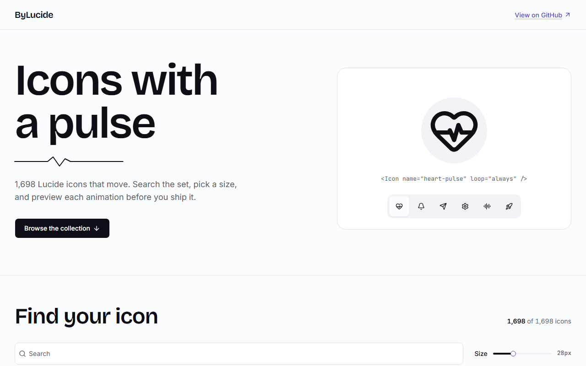
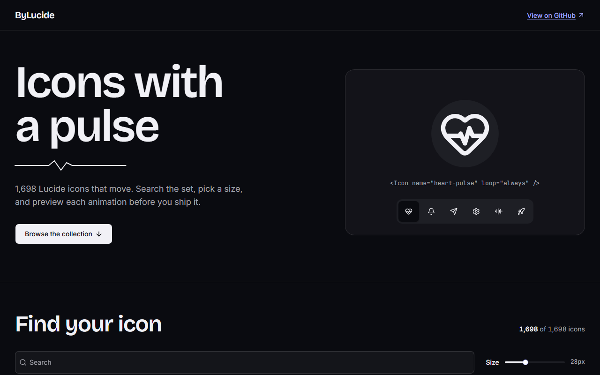
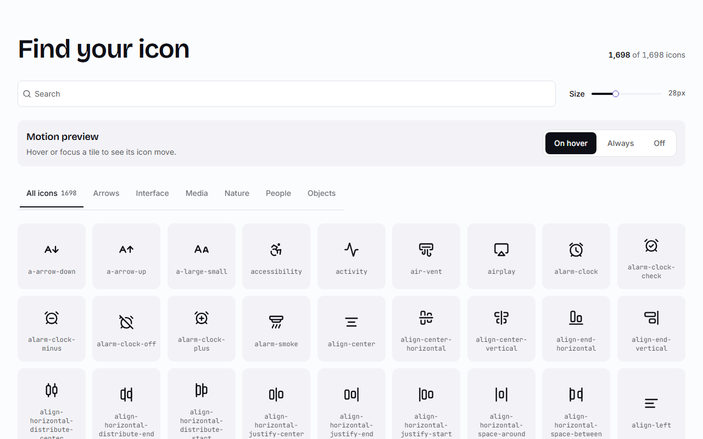
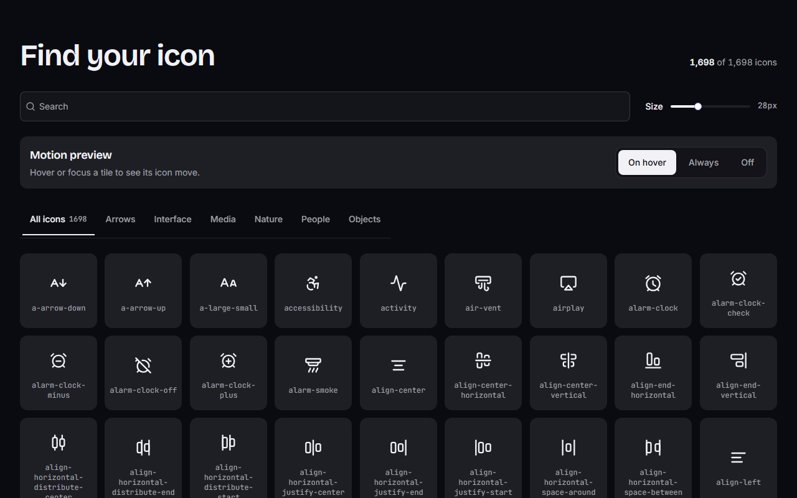
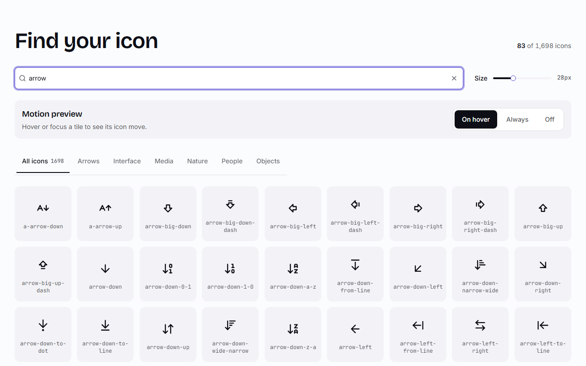
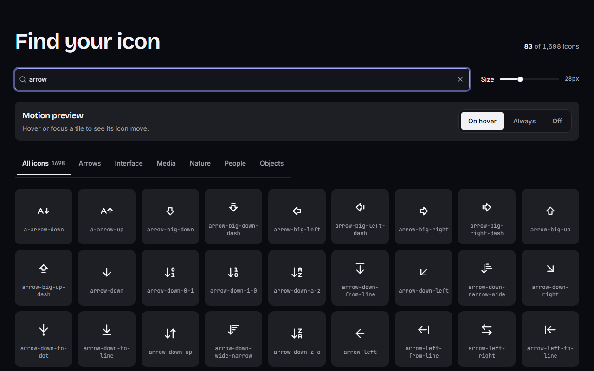
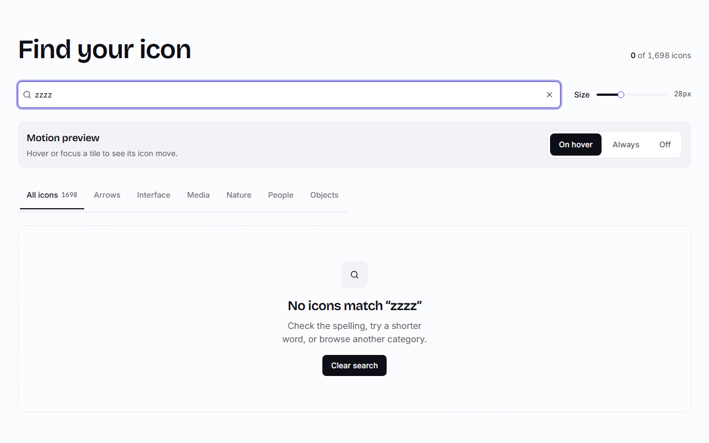
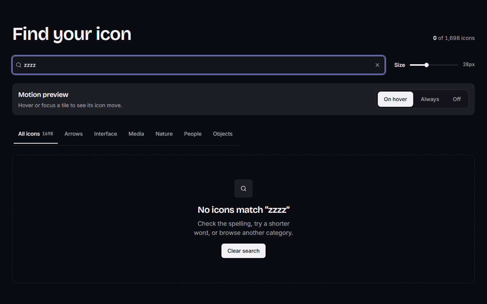

# bylucide

Biblioteca React interna da appby com os ícones Lucide animados: 1.698 implementações animadas locais e fallback estático do `lucide-react` para os demais nomes, com a mesma API de nomes do `lucide-react`.



## O que faz

- Exporta componentes nomeados iguais aos do `lucide-react` (`ArrowDownIcon`, `ChevronDown`, `LucideHouse`, aliases como `Home` e `Loader2`), cobrindo os 6.411 exports do `lucide-react@1.55.0`.
- Seleciona ícones por nome em tempo de execução com `<Icon name="..." />`, `normalizeName` e o `manifest` com nomes e aliases.
- Anima o ícone no hover e no foco de teclado do controle pai (botão, link, item de menu, opção de select, aba), com `loop="hover" | "always" | false` e `trigger="parent" | "self"`.
- Respeita `prefers-reduced-motion` por padrão (`reducedMotion="system"`) e troca para o ícone estático do `lucide-react`.
- Traz um demo (`demo/`) para buscar no catálogo, mudar o tamanho, comparar os modos de animação e copiar o nome do ícone.

## Telas

As telas são do demo.

| Tela | Claro | Escuro |
|---|---|---|
| Início |  |  |
| Catálogo |  |  |
| Busca |  |  |
| Busca sem resultado |  |  |

Prints em 1280 × 800 gerados com Playwright: `bun run screenshots` (spec `e2e/screenshots.e2e.ts`).

## Stack

- Biblioteca: React 18 ou superior (peer), TypeScript, `motion` 14.1.0 e `lucide-react` 1.55.0 como dependências externas, para o bundler do app manter só os ícones importados.
- Build: `tsup` (ESM + declarações em `dist/`), Bun para scripts e testes.
- Demo: Vite 8, Tailwind CSS 4, ByUI com o tema `bylucide`, e os ícones do próprio `src/`.

## Rodar localmente

Pré-requisitos: Bun (o CI usa 1.3.14). O demo instala o ByUI pelo git (`appbydev/byui`, privado), então é preciso acesso SSH ao GitHub.

```sh
bun install
bun run build        # biblioteca em dist/
bun run demo         # demo em http://localhost:5409
bun run demo:build   # demo em demo/dist; preview: bunx vite preview --config demo/vite.config.ts (porta 5419)
```

Não há variáveis de ambiente.

Para usar em outro projeto, instale pelo git com a tag da versão:

```jsonc
"dependencies": {
  "bylucide": "git+https://github.com/appbydev/bylucide.git#v0.2.0"
}
```

```tsx
import { ArrowDownIcon, Icon } from 'bylucide';

<button type="button">
  Baixar <ArrowDownIcon aria-hidden="true" />
</button>
<Icon name="plane" aria-label="Avião" loop="always" />
```

A referência completa de propriedades (`name`, `size`, `color`, `strokeWidth`, `loop`, `reducedMotion`, `trigger`, `ref`), acessibilidade, catálogo, aliases, `createIcon` e limites conhecidos está em [docs/api.md](docs/api.md).

## Testes

```sh
bun run typecheck   # TypeScript da biblioteca
bun test            # unitários (catálogo, comportamento e renderização dos ícones)
bun run test:e2e    # Playwright no demo, servido com vite preview na porta 5419
```

O e2e (`e2e/catalog.e2e.ts`) cobre o seletor do hero, a busca com estado vazio, as abas de categoria, o slider de tamanho, os modos de animação, a cópia do nome, a ausência de overflow em 390 px (claro e escuro) e que cada célula anima o próprio ícone no hover e no foco. Na primeira vez, rode `bunx playwright install chromium`.

## Estrutura

```
src/                  biblioteca: API pública, runtime, registro e ícones animados
  icons/              um módulo por ícone animado
  icon-manifest.json  nomes canônicos e aliases
scripts/              generate-icons.ts e o script de versionamento (ci/)
dist/                 build publicado (consumido pelo git)
demo/                 demo do catálogo (Vite + ByUI)
e2e/                  testes Playwright do demo e gerador de prints
docs/                 referência da API e prints
```

Após atualizar a versão fixada de `lucide-react`, rode `bun run generate:icons` para regenerar exports, resolução e aliases, e reconstrua `dist`.

## Deploy e versionamento

O demo vai para o GitHub Pages pelo workflow `pages.yml` a cada push na `main`.

Versionamento automático (`release.yml`): cada push na `main` gera versão, tag e release a partir dos Conventional Commits (`feat!` major, `feat` minor, `fix`/`refactor`/`perf` patch; `chore`/`ci`/`docs`/`style`/`test` sem release). Os projetos sobem de versão trocando a tag no `package.json`. O CI precisa do secret `BYUI_DEPLOY_KEY` (deploy key somente leitura do repositório `byui`) para instalar o ByUI.

## Documentação

- [docs/api.md](docs/api.md): API, acessibilidade, catálogo e limites conhecidos
- [DESIGN.md](DESIGN.md): contrato de design do demo
